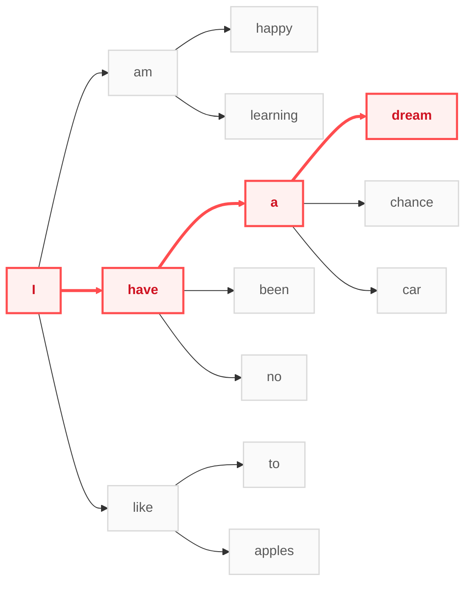

[阅读中文版]()

> Wit beyond measure is man's greatest treasure. — J.K. Rowling

Agents, represented by large language models, have made unimaginable strides in recent years: they write prose swiftly and eloquently, derive mathematical proofs rapidly and accurately, and generate code that is both precise and concise. Before long, agents may truly integrate into our daily lives and take over a vast amount of our work. This inevitably raises profound questions: What will agents look like in five or ten years? Will our work still require human involvement? Where does the true boundary of an agent lie?

Borrowing the lens of reinforcement learning pioneer Rich Sutton in _The Bitter Lesson_, we can view today’s agents as a paradigm that successfully scales through Search and Learning:

- **Search here means:** Given an input, the agent selects the next output token one by one from a space of candidate tokens until termination.
- **Learning here means:** Through next-token prediction methods—whether via supervised learning, reinforcement learning, or diffusion—the agent learns how to search for the next token.

The mission of artificial intelligence is to study and understand "intelligence." If we adopt Sutton’s definition—intelligence is the domain-independent part of the ability to achieve goals—then what we are currently confident in realizing is precisely the "search" component of it.

We can naturally generalize this notion of search: anything that follows the loop of "being in a current state $\rightarrow$ selecting an action $\rightarrow$ transitioning to the next state" can be handled by this search paradigm. Writing, for instance, is selecting the next word given a sequence of preceding words; sweeping the floor, likewise, is naturally deciding where to clean next given the current layout of clean and messy areas. This is the premise upon which future agents will achieve widespread adoption: search-based methods are sufficient to handle the vast majority of tasks in our daily lives and work. Moreover, agent-based search is vastly cheaper than human search. Herein lies the root of our anxiety—the fear that AI will replace most jobs, leaving us with nowhere to stand.

Yet I believe this anxiety magnifies what we need not fear, while overlooking what truly warrants our vigilance.

**First, let us look at the magnified, unnecessary anxiety.**

On the one hand, search-based intelligence is by no means the entirety of intelligence; on the other hand, the real world is far larger than any world an agent can model. Search-based agents can certainly solve complex mathematical problems, but many "flashes of insight" cannot be cheaply found through search. Within human intelligence, there remains much that is not search-based—elements that may not always drive earth-shattering paradigm shifts, yet tangibly help us do our everyday work better. As for what this "non-search intelligence" specifically entails, we may not yet have a complete definition, and figuring that out is a task left for all of us. What we truly ought to do is offload more of the "search" part of our intellect to external agents, leveraging their efficient search to explore the next frontier of human wisdom.

**Second, let us examine where people may be overly optimistic.**

Many fall into blind optimism because they mistake tasks where "I am still capable, and agents temporarily fall short" for the true boundaries of agents. Examples include processing multimodal inputs, executing physical actions in the real world, or capabilities people used to cherish—such as long-horizon planning, making final executive calls, or even bearing responsibility and accountability. In truth, under the logic of "search versus non-search," none of these represent the true boundary of intelligence: the former still fall within the broad category of state-action search, while the latter are merely divisions of rules within human society. We should certainly acknowledge that there are things agents cannot do, but we need to rethink and anticipate what kind of world we will inhabit, and how we should adapt to it.

In short, today's agents can be viewed as search-based systems capable of accomplishing feats that were once—and even now remain—hard to imagine. Yet at the same time, we still possess "wit beyond measure," and that remains our greatest treasure. Perhaps in 10 or 20 years, search-based intelligence will genuinely enter the everyday scenarios I have predicted. And it is precisely as the boundary of search continues to expand that we will peel back the layers and see, with growing clarity, the parts of human intelligence that do not belong to search—thereby truly understanding ourselves and this brave new world.
