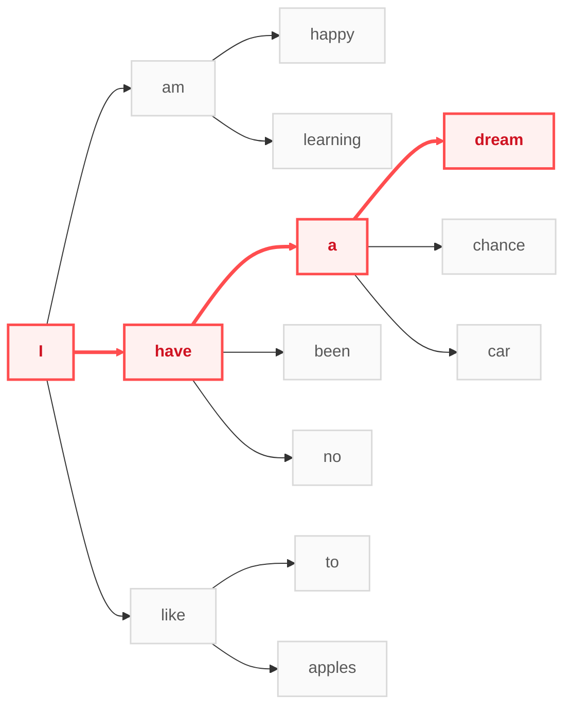

[Read in English]()

> 无法衡量的智慧，是人最大的财富。 —— J.K. 罗琳

以大模型为代表的智能体（Agents）在过去一段时间里取得了超乎想象的进步：它们可以把文章写得又快又好，把数学推导得又快又对，把代码写得既准确又简洁。未来，智能体或许能够真正进入我们的日常生活，完成大量的工作。这不得不引人深思：五年后、十年后的智能体会是什么样？我们的工作是否还需要人的参与？智能体的边界究竟在哪里？

借用强化学习先驱 Rich Sutton 在 _The Bitter Lesson_ 中的视角，我们可以将如今的智能体视为一种在搜索（Search）与学习（Learning）下成功扩展的范式：

- **这里的搜索**：给定一段输入，智能体在备选的 token 空间中，一个接一个地选择下一个输出的 token，直到结束。
- **这里的学习**：智能体通过预测下一个 token 的方法（无论是监督学习、强化学习还是 Diffusion），学习如何去搜索下一个 token。

人工智能的使命是研究并理解“智能”。如果借用 Sutton 的定义——智能是实现目标的能力中与具体领域无关的那部分（_Intelligence is the domain-independent part of the ability to achieve goals_）——那么目前我们有信心实现的，正是其中“搜索”的部分。

我们可以很自然地泛化这种搜索：任何“处于当前状态 $\rightarrow$ 选择动作 $\rightarrow$ 进入下一个状态”的事物，都可以被这种搜索范式所处理。例如文字类的工作，是在一系列当前文字下，选择接下来的文字；再如扫地，处于当前干净或脏乱的区域，我们会自然考虑下一步如何打扫。这是未来智能体能够得到广泛发展的前提：**基于搜索的方法，足以处理日常生活和工作中的大部分任务。** 并且，基于智能体的搜索比人类自己做搜索要便宜得多——这正是我们焦虑的根源：担心人工智能取代绝大部分岗位，而我们终将无所适从。

但我认为，这种焦虑**放大了不必要担忧的部分，却忽略了真正值得警惕的部分。**

**首先来看被放大的、不必要的焦虑。**

一方面，基于搜索的智能，绝不是智能的全部；另一方面，真实世界比任何一个智能体能够建模的世界都要大得多。基于搜索的智能体当然可以解决很多复杂的数学问题，但许多“灵光乍现”的点子，并不能靠基于搜索的方法很便宜地搜出来。在人类的智慧中，还有许多不基于搜索的部分——它们未必是惊天动地的范式转移，却实实在在地帮助我们把日常工作做得更好。至于这些“非搜索的智慧”具体是什么，我们现在或许还无法给出一个完备的定义，但这本来就是留给我们所有人的课题。我们真正应该做的，是把智力中属于“搜索”的部分更多地转移给外界的智能体，借助外物的高效搜索，并探索人类智慧的下一步。

**其次来看目前大家可能过分乐观的部分。**

很多人之所以盲目乐观，是因为把一些“目前我还行、智能体暂时做不到”的事情，误当成了智能体真正的边界。例如处理多模态的输入、在真实世界中执行物理动作；又或者以前人们常说的“执行长程规划的能力”、“拍板做决策的能力”，甚至是“承担责任的能力”。其实，从“搜索与非搜索”的逻辑来看，这些都算不上智能真正的边界——前几项依然属于广义的状态-动作搜索范畴，而后几项更多是人类社会的规则划分。我们当然应该承认智能体做不了某些事情，但我们需要重新认知和推测：我们将处于一个什么样的世界，又该如何去适应这个世界。

总之，目前的智能体可以视作是基于搜索的，它们能够完成许多过去乃至未来都难以想象的事情。但与此同时，**我们依然拥有目前“无法衡量的智慧”，这正是我们最大的财富。** 或许未来 10 年、20 年后，基于搜索的智能真的可以进入我所预测的这些日常场景；而恰恰是在搜索边界不断拓展的过程中，我们也能像剥茧抽丝一样，越来越清晰地看清人类智能中那些“不属于搜索”的部分，从而真正认识我们自己，认识这个新的世界。
